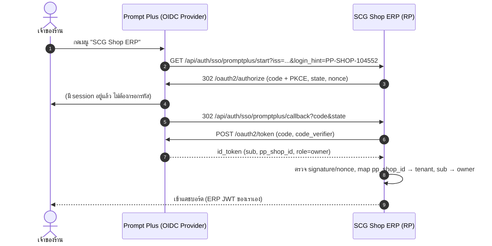
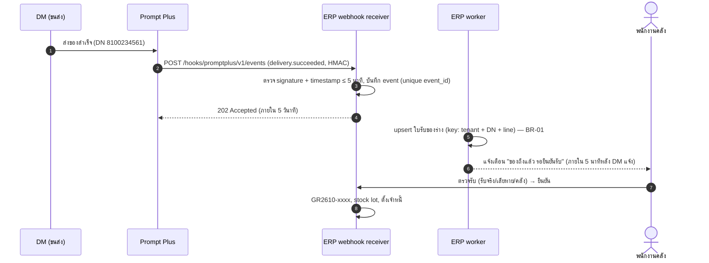
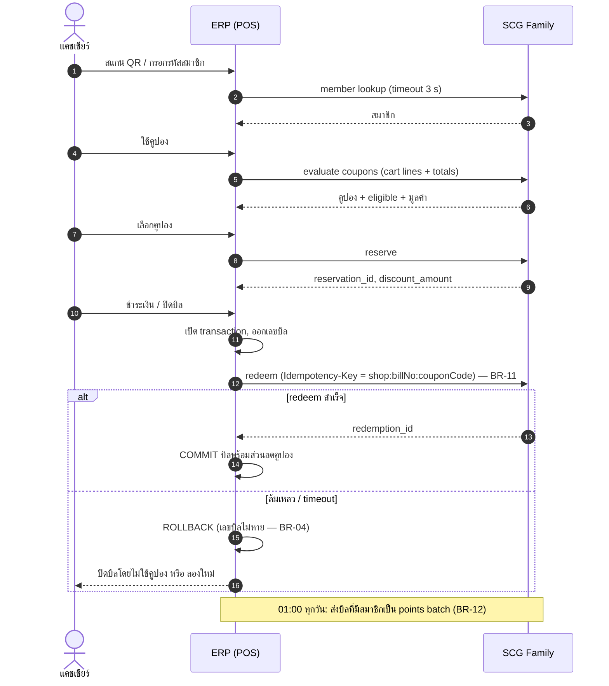

# Integration Specifications — Prompt Plus และ SCG Family

สถานะ: **Draft v0.1 (2026-10-27) — เพื่อ review** · ยังไม่มีการเชื่อม API จริง
ผู้อ่าน: ทีม Prompt Plus, ทีม SCG Family, ทีมภาษี SCG, ทีม SCG Shop ERP (ทีมเรา)

เอกสารชุดนี้กำหนด **สัญญาการเชื่อมต่อ (integration contract)** ระหว่าง SCG Shop ERP กับระบบของ SCG สองระบบ เพื่อให้แต่ละทีม review และสร้าง/ยืนยันฝั่งของตัวเองได้ก่อนเริ่มเชื่อมจริง ทุก endpoint ที่เป็นของ Prompt Plus หรือ SCG Family ในเอกสารนี้เป็น **ข้อเสนอ (proposed)** ถ้าทีมนั้นมี API อยู่แล้ว ให้ตอบกลับใน Open questions แล้วเราจะปรับ mapping ตาม

| ไฟล์ | เนื้อหา |
|---|---|
| [`promptplus.md`](promptplus.md) | Prompt Plus: owner SSO, product master + dealer sync, สินค้ากำลังมา, delivery → ใบรับของร่าง, ยืนยันรับจาก order, สั่งซื้อจากใบเสนอราคา/ใบสั่งขาย |
| [`scgfamily.md`](scgfamily.md) | SCG Family (M13): ค้นสมาชิก, คูปอง (evaluate / reserve / redeem / release), คะแนนรายวัน, reconciliation, การแสดงคูปองในใบกำกับภาษี |
| [`onprem-delivery-file.md`](onprem-delivery-file.md) | ภาคผนวก: ไฟล์ใบส่งของ/คำสั่งซื้อแบบ generic สำหรับ On-premise (CSV/XLSX) |
| [`openapi/promptplus.yaml`](openapi/promptplus.yaml) | OpenAPI 3.1 draft ของ Prompt Plus API + webhooks ที่ส่งมาหาเรา |
| [`openapi/scgfamily.yaml`](openapi/scgfamily.yaml) | OpenAPI 3.1 draft ของ SCG Family API + endpoint ฝั่งเราที่ SCG Family เรียก |
| [`schemas/`](schemas/) | JSON Schema (draft 2020-12) ของ webhook payload แต่ละ event |
| [`samples/delivery-sample.csv`](samples/delivery-sample.csv) | ตัวอย่างไฟล์ใบส่งของสำหรับ On-premise |

OpenAPI ทั้งสองไฟล์อ้าง webhook payload จาก `schemas/` ด้วย `$ref` แบบ relative (JSON Schema คือ source of truth ของ event body) — เปิดใน Swagger/Redocly ให้เปิดทั้งโฟลเดอร์ `docs/integrations/` ไม่ใช่ไฟล์เดียว ตรวจความถูกต้องได้ด้วย:

```bash
python3 -c "import yaml,sys; [yaml.safe_load(open(f)) for f in sys.argv[1:]]" docs/integrations/openapi/*.yaml
pip install openapi-spec-validator && python3 -c "import yaml,os; from openapi_spec_validator import validate; [validate(yaml.safe_load(open(f)), base_uri='file://'+os.path.abspath(f)) for f in ['docs/integrations/openapi/promptplus.yaml','docs/integrations/openapi/scgfamily.yaml']]"
```
ตัวอย่าง (`examples`) ในทุกไฟล์ JSON Schema ผ่านการตรวจด้วย Ajv (draft 2020-12 + formats)

---

## 1. ขอบเขตและ Edition

| | Cloud (`EDITION=cloud`) | On-premise (`EDITION=onprem`) |
|---|---|---|
| Prompt Plus API (SSO, master, orders, deliveries) | ใช่ | **ไม่มี** — โค้ดไม่ถูก compile เข้า build (`scripts/check-onprem.mjs` ตรวจใน CI) |
| SCG Family (สมาชิก / คูปอง / คะแนน) | ใช่ (OQ-A2) | **ไม่มี** — SCG Family ยืนยันว่าร้าน on-prem ไม่ต้องใช้คูปอง (OQ-A2) |
| รับของจาก SCG | ใบรับของร่างอัตโนมัติจาก delivery event | ซื้อเข้าแบบบันทึกเอง (REQ-M05-06) หรือ **นำเข้าไฟล์ใบส่งของ** ([`onprem-delivery-file.md`](onprem-delivery-file.md)) |

ข้อกำหนดของ build on-prem: ห้ามมีชื่อ/URL/env ของ Prompt Plus ใน payload on-prem (`/promptplus/i`, `/prompt[\s_-]plus/i`, `PROMPTPLUS_*`) ดังนั้นฟีเจอร์นำเข้าไฟล์ใน on-prem ต้องตั้งชื่อแบบ generic (เช่น "นำเข้าใบส่งของ") และเมื่อรู้ hostname จริงของ Prompt Plus ให้เพิ่ม `--pattern` ใน CI

โค้ดที่เกี่ยวข้อง ณ commit `e0baede` (ยังเป็น stub; อาจย้ายที่ระหว่างการจัดโครงสร้างโค้ด): `apps/server/src/adapters/promptplus.ts`, `apps/server/src/adapters/scgfamily.ts`, route `GET /api/promptplus/incoming`, `POST /api/promptplus/orders`, capability flags ใน `packages/contracts/src/meta.ts`

---

## 2. ใครเป็นเจ้าของอะไร (Ownership)

| เรื่อง | Source of truth | ERP ทำอะไร |
|---|---|---|
| ตัวตนเจ้าของร้าน (owner identity) ที่มาจาก Prompt Plus | Prompt Plus (OIDC Provider) | เป็น OIDC Relying Party, map `sub` → user owner ของ tenant |
| Product master สินค้า SCG (ชื่อ, รูป, หมวดตั้งต้น, หน่วย, barcode) | Prompt Plus | sync ลง `products` (`is_scg = true`), ร้านแก้ราคาขาย/หมวด/จุดสั่งซื้อได้ แต่แก้ชื่อสินค้า SCG ไม่ได้ |
| ผู้แทนจำหน่าย (dealer) ที่ร้านผูกไว้ | Prompt Plus | สร้าง/อัปเดต `vendors` อัตโนมัติ (แก้เงื่อนไขชำระเงินได้) |
| คำสั่งซื้อ (order) และสถานะ | Prompt Plus | แสดง "สินค้ากำลังมา", สร้าง order จาก QT/SO |
| การจัดส่ง (DN) | Prompt Plus / DM (ระบบขนส่ง) | สร้างใบรับของร่าง 1 ใบต่อ 1 DN, สต็อกเพิ่มเมื่อร้านยืนยันเท่านั้น |
| สต็อก, ต้นทุน FIFO, เจ้าหนี้ | **ERP** | — |
| สมาชิก SCG Family, คูปอง, เงื่อนไขคูปอง, มูลค่าคูปอง | SCG Family | ส่งตะกร้าให้ evaluate, จอง, ตัดใช้, คืนสิทธิ์ |
| การเบิกคืนค่าคูปองให้ร้าน (reimbursement) | **SCG Family (นอกระบบเรา)** — OQ-01 ตอบแล้ว | ให้รายงานการใช้คูปอง (REQ-M11-05) และ endpoint reconciliation (REQ-M13-07) เท่านั้น |
| คะแนนสะสม (points) และสินค้าที่ได้คะแนน | SCG Family (BR-12) | ส่งบิลที่มีรหัสสมาชิกเป็น batch รายวัน |
| ใบกำกับภาษี, VAT, เลขที่เอกสาร | **ERP** | — |

---

## 3. ภาพรวม Sequence

### 3.1 Owner SSO จากเมนู Prompt Plus (REQ-M01-01)



### 3.2 Delivery สำเร็จ → ใบรับของร่าง (REQ-M05-02)



### 3.3 ขายหน้าร้านพร้อมคูปอง SCG Family (M13)



---

## 4. Environments

| | Sandbox | Production |
|---|---|---|
| Prompt Plus API | `https://api-sandbox.promptplus.example` *(TBD)* | `https://api.promptplus.example` *(TBD)* |
| Prompt Plus OIDC issuer | `https://id-sandbox.promptplus.example` *(TBD)* | `https://id.promptplus.example` *(TBD)* |
| SCG Family API | `https://api-sandbox.scgfamily.example` *(TBD)* | `https://api.scgfamily.example` *(TBD)* |
| ERP (cloud) — รับ webhook / partner API | `https://sandbox.scgshop-erp.example` *(TBD)* | `https://app.scgshop-erp.example` *(TBD)* |

- Sandbox ใช้ข้อมูลทดสอบเท่านั้น ห้ามใช้ข้อมูลสมาชิกจริง (PDPA)
- แต่ละ environment มี `client_id`/`client_secret`, webhook secret และ OIDC client แยกกัน
- ทุกทีมต้องเตรียม **ร้านทดสอบ** ที่ตรงกัน: Prompt Plus shop `PP-SHOP-TEST-001`, SCG Family shop `SFM-TEST-001`, ERP tenant `charoen` (seed)
- ERP ฝั่ง cloud อ่าน config จาก env: `PROMPTPLUS_BASE_URL`, `PROMPTPLUS_CLIENT_ID`, (เสนอเพิ่ม) `PROMPTPLUS_CLIENT_SECRET`, `PROMPTPLUS_OIDC_ISSUER`, `PROMPTPLUS_WEBHOOK_SECRETS`, `SCGFAMILY_BASE_URL`, `SCGFAMILY_CLIENT_ID`, `SCGFAMILY_CLIENT_SECRET`, `SCGFAMILY_WEBHOOK_SECRETS` — secret เก็บใน secret manager ไม่เก็บใน DB

---

## 5. Authentication

### 5.1 Server-to-server: OAuth 2.0 Client Credentials (แนะนำ)

- ERP ขอ token: `POST {issuer}/oauth2/token`, `grant_type=client_credentials`, `client_id` + `client_secret` (หรือ `private_key_jwt` ถ้าทีมนั้นรองรับ — ดีกว่า), `scope=...`
- Access token เป็น JWT อายุ 5–60 นาที; ERP cache token ต่อ environment และต่ออายุก่อนหมด 60 วินาที
- ส่ง `Authorization: Bearer <token>` ทุก request; **ห้ามใช้ header `x-client-id` อย่างเดียว** (stub ปัจจุบันใช้แบบนั้นชั่วคราว)
- ร้านระบุผ่าน path (`/v1/shops/{ppShopId}/...`) และ token ต้องมีสิทธิ์เฉพาะร้านที่ผูกกับ ERP แล้ว (ฝั่ง partner ตรวจว่า shop นั้น consent ให้ ERP เข้าถึง)
- Scopes ที่เสนอ:
  - Prompt Plus: `pp.catalog.read`, `pp.dealers.read`, `pp.orders.read`, `pp.orders.write`, `pp.deliveries.read`, `pp.receipts.write`
  - SCG Family: `sf.members.read`, `sf.coupons.evaluate`, `sf.coupons.redeem`, `sf.points.write`, `sf.reconciliation.read`
- ทิศทางกลับ (partner เรียก ERP เช่น reconciliation): ERP เป็น authorization server แบบเดียวกัน ออก client credentials ให้ partner, scope `erp.partner.reconciliation.read`

### 5.2 Owner SSO: OpenID Connect Authorization Code + PKCE

- Prompt Plus เป็น OpenID Provider, ERP เป็น Relying Party
- Flow: Authorization Code + PKCE (S256), `state` + `nonce`, `response_mode=query`
- เริ่มได้จากฝั่ง Prompt Plus ด้วย OIDC "third-party initiated login" (`initiate_login_uri` = `https://app.scgshop-erp.example/api/auth/sso/promptplus/start`)
- Claims ที่ต้องการ: `sub`, `pp_shop_id`, `pp_role` (`owner` เท่านั้นในเฟสนี้), `name`, `email` (optional), `amr`
- ERP ออก JWT session ของตัวเองหลัง login — ไม่ใช้ token ของ Prompt Plus เรียก API ของ ERP
- Logout: ERP ลบ session ของตัวเอง; RP-initiated logout ไป Prompt Plus เป็น optional (open question)

---

## 6. Versioning

- Major version อยู่ใน URL (`/v1/...`) และใน webhook envelope (`api_version: "2026-10-01"` แบบวันที่)
- เปลี่ยนแบบ **additive** (เพิ่ม field, เพิ่ม enum value ที่ผู้รับ ignore ได้, เพิ่ม endpoint) ไม่ต้องขึ้น version — ผู้รับต้อง **ignore field ที่ไม่รู้จัก**
- Breaking change → `/v2` และรัน `/v1` คู่กันอย่างน้อย 6 เดือน; endpoint ที่จะเลิกใช้ส่ง header `Deprecation` และ `Sunset` (RFC 8594)
- Enum ใหม่: ผู้รับต้องมี fallback (เช่น สถานะ order ที่ไม่รู้จัก → แสดงเป็น "อื่น ๆ" และ log)

## 7. Rate limits

| API | ข้อเสนอ |
|---|---|
| Prompt Plus | 10 req/s ต่อ client, burst 20; `/catalog/products` ใช้ `updated_since` + cursor ไม่ดึงทั้งหมดทุกครั้ง |
| SCG Family (realtime POS) | 50 req/s ต่อ client รวมทุกร้าน, 5 req/s ต่อร้าน |
| SCG Family points batch | 1 batch ต่อร้านต่อวัน, ≤ 5,000 บิลต่อ request (แบ่ง chunk) |
| ERP partner API | 5 req/s ต่อ partner client |

เกิน limit ตอบ `429` พร้อม `Retry-After` (วินาที) และควรมี `RateLimit-Limit`, `RateLimit-Remaining`, `RateLimit-Reset`

## 8. Idempotency

- ทุก `POST` ที่สร้าง/เปลี่ยนสถานะต้องส่ง header `Idempotency-Key` (≤ 128 ตัวอักษร)
- ผู้รับเก็บ key + hash ของ body อย่างน้อย 7 วัน (คูปอง: 90 วัน)
  - key เดิม + body เดิม → ตอบผลเดิม (status เดิม, body เดิม) และควรมี header `Idempotent-Replayed: true`
  - key เดิม + body ต่าง → `409 IDEMPOTENCY_KEY_REUSED`
  - key เดิมกำลังประมวลผลอยู่ → `409 IN_PROGRESS` (ผู้เรียก retry หลัง backoff)
- Key ที่กำหนดในสเปกนี้:

| Operation | Idempotency-Key |
|---|---|
| สร้าง Prompt Plus order จาก QT/SO | `erp:{tenantCode}:pporder:{sourceDocNo}:{attemptUuid}` — attemptUuid สร้างตอนเปิดหน้าสั่ง ใช้ซ้ำเมื่อ retry |
| แจ้ง Prompt Plus ว่ารับของแล้ว | `erp:{tenantCode}:receipt:{grNo}` |
| จองคูปอง | `erp:{sfShopId}:reserve:{cartSessionUuid}:{couponCode}` |
| ตัดคูปอง (BR-11) | `{sfShopId}:{billNo}:{couponCode}` |
| คืนสิทธิ์คูปอง | `erp:{sfShopId}:release:{reservationId}` / `erp:{sfShopId}:reverse:{redemptionId}` |
| points batch | `{sfShopId}:{yyyy-mm-dd}:{chunkNo}` |

- Webhook (ขาเข้าหาเรา): dedupe ด้วย `event_id` (unique ต่อ source) และ **business key** ตามแต่ละ event เช่น DN + line (BR-01) — ป้องกันกรณี partner ส่ง event ใหม่ (id ใหม่) ของ DN เดิม

## 9. Retries และ backoff

ฝั่งผู้เรียก (ERP → partner):
- Retry เฉพาะ: network error, timeout, `408`, `429`, `502`, `503`, `504` และเฉพาะ request ที่ idempotent (GET) หรือมี `Idempotency-Key`
- Exponential backoff + full jitter: `sleep = random(0, min(cap, base × 2^attempt))`, base 1 s, cap 60 s, สูงสุด 5 ครั้ง (งาน background)
- เคารพ `Retry-After` เสมอ
- **ยกเว้น POS realtime (SCG Family):** budget รวม 3 วินาทีต่อการกระทำของแคชเชียร์ — retry ได้อย่างมาก 1 ครั้งภายใน budget แล้วถือว่าล้มเหลว ให้ POS ทำงานต่อโดยไม่มีคูปอง
- Circuit breaker: ล้มเหลว ≥ 50% ใน 30 วินาที (ขั้นต่ำ 10 calls) → เปิด 30 วินาที ระหว่างนั้น POS แสดง "SCG Family ไม่พร้อม" ทันทีไม่ต้องรอ 3 วินาที

ฝั่งผู้ส่ง webhook (partner → ERP):
- ERP ตอบ `2xx` หลังบันทึก event ลง DB แล้วเท่านั้น (ภายใน 5 วินาที) แล้วประมวลผลแบบ async
- `4xx` (ยกเว้น 408/429) = ไม่ต้อง retry (เช่น signature ผิด); `5xx`/timeout = retry
- ตาราง retry ที่เสนอ: 1 นาที, 5 นาที, 15 นาที, 1 ชม., 3 ชม., 6 ชม., แล้วทุก 6 ชม. จนครบ 72 ชม.
- ERP มี **polling fallback**: ทุก 10 นาทีดึง `GET .../deliveries?updated_since=` เพื่อเก็บ event ที่ตกหล่น (dedupe ด้วย business key เดียวกัน)

## 10. Webhook signature (HMAC-SHA256 + timestamp)

Headers ที่ผู้ส่งต้องใส่:

```
X-Webhook-Id: evt_01JBC6Z8Q4M2N7T5V9X3Y1K0AB
X-Webhook-Timestamp: 1761528120            # Unix seconds
X-Webhook-Signature: v1=5f0c...e9a1        # hex(HMAC_SHA256(secret, timestamp + "." + raw_body))
```

การตรวจของผู้รับ:
1. อ่าน **raw body bytes** ก่อน parse JSON
2. `abs(now - timestamp) ≤ 300` วินาที ไม่เช่นนั้นตอบ `401 STALE_TIMESTAMP` (replay window 5 นาที)
3. คำนวณ `expected = hex(HMAC_SHA256(secret, f"{timestamp}.{raw_body}"))`, เปรียบเทียบแบบ constant-time กับทุก `v1=` ใน header (คั่นด้วย `,` — รองรับ secret 2 ตัวระหว่าง rotate)
4. ตรวจว่า `X-Webhook-Id` == `id` ใน body และยังไม่เคยประมวลผล (เก็บ id อย่างน้อย 72 ชม. + replay window)
5. ตอบ `202` (ใหม่) หรือ `200` (ซ้ำ ประมวลผลแล้ว)

Secret: สุ่ม ≥ 32 bytes ต่อ environment, rotate ได้โดยส่ง signature คู่ระหว่างช่วงเปลี่ยน, ส่งผ่านช่องทางปลอดภัย (ไม่ส่งทางอีเมล) ตัวอย่าง (Node):

```ts
const expected = createHmac('sha256', secret).update(`${ts}.${rawBody}`).digest('hex');
const ok = sigs.some((s) => s.length === expected.length && timingSafeEqual(Buffer.from(s), Buffer.from(expected)));
```

Envelope ของทุก event (ดู [`schemas/common/webhook-envelope.schema.json`](schemas/common/webhook-envelope.schema.json)):

```json
{
  "id": "evt_01JBC6Z8Q4M2N7T5V9X3Y1K0AB",
  "type": "delivery.succeeded",
  "api_version": "2026-10-01",
  "occurred_at": "2026-10-22T09:42:11+07:00",
  "shop_id": "PP-SHOP-104552",
  "data": { }
}
```

## 11. Error format

ทุก API ในสเปกนี้ (ทั้ง partner และ ERP) ใช้ JSON รูปเดียวกับ API ภายในของ ERP (`ApiError` ใน `packages/contracts`) เพิ่ม `trace_id`:

```json
{
  "code": "COUPON_NOT_ELIGIBLE",
  "message": "ยอดสินค้า SCG ร่วมรายการไม่ถึง 1,000 บาท",
  "details": { "required": "1000.00", "actual": "860.00" },
  "trace_id": "4bf92f3577b34da6a3ce929d0e0e4736"
}
```

| HTTP | `code` ทั่วไป | ความหมาย |
|---|---|---|
| 400 | `VALIDATION` | body/query ไม่ผ่าน schema — `details` เป็นรายการ field |
| 401 | `UNAUTHORIZED`, `INVALID_SIGNATURE`, `STALE_TIMESTAMP` | token/ลายเซ็นไม่ถูกต้อง |
| 403 | `FORBIDDEN`, `SHOP_NOT_LINKED` | ไม่มีสิทธิ์ในร้านนี้ |
| 404 | `NOT_FOUND` | |
| 409 | `CONFLICT`, `IDEMPOTENCY_KEY_REUSED`, `IN_PROGRESS` + code เฉพาะ domain | สถานะไม่ตรง |
| 422 | code เฉพาะ domain (เช่น `COUPON_NOT_ELIGIBLE`) | ข้อมูลถูก schema แต่ผิดกฎธุรกิจ |
| 429 | `RATE_LIMITED` | ดู `Retry-After` |
| 5xx | `INTERNAL`, `UNAVAILABLE` | retry ได้ |

- `message` เป็นภาษาไทยที่แสดงให้ผู้ใช้ร้านเห็นได้ (ไม่ใส่ stack trace หรือข้อมูลส่วนบุคคล)
- ทุก request ส่ง `traceparent` (W3C Trace Context) เพื่อไล่ log ข้ามระบบ

## 12. รูปแบบข้อมูลร่วม

- เงินและจำนวนเป็น **decimal string** (`"121.00"`, `"200.0000"`) ไม่ใช้ JSON number — ตรงกับ contract ของ ERP
- เวลาเป็น RFC 3339 พร้อม offset (`2026-10-22T09:42:11+07:00`), วันที่ทางธุรกิจเป็น `YYYY-MM-DD` ตามเวลาประเทศไทย (Asia/Bangkok)
- ข้อความเป็น UTF-8; JSON field เป็น `snake_case` ฝั่ง partner (ERP map เป็น camelCase ภายใน)
- ทุก list ใช้ cursor paging: `?limit=` (≤ 100) `&cursor=` → `{ "items": [...], "next_cursor": "..." | null }`
- หน่วยสินค้า: partner ส่ง `unit_code` + `unit_name` + `base_factor` (จำนวนหน่วยฐานต่อ 1 หน่วยนี้) ERP map ไป `products.units[]`

## 13. PDPA และความปลอดภัยข้อมูล

- **Data minimization:** ERP เก็บเฉพาะ `member_id` (รหัส SCG Family) บนบิล (`docs.member_id` มีอยู่แล้ว) ชื่อ/ระดับสมาชิกใช้แสดงบนจอเท่านั้น ไม่บันทึกลง DB; เบอร์โทรที่ใช้ค้นไม่บันทึก
- **Legal basis / consent:** SCG Family เป็นผู้ควบคุมข้อมูล (data controller) ของข้อมูลสมาชิกและเป็นผู้ขอ consent ในแอป; ERP/ร้านใช้ข้อมูลตามวัตถุประสงค์คูปอง/คะแนนเท่านั้น — ต้องมี **Data Processing Agreement (DPA)** ระหว่าง SCG Family, ผู้ให้บริการ ERP และร้าน (open question ด้านกฎหมาย)
- Owner SSO: เก็บ `sub`, `pp_shop_id`, ชื่อ, อีเมล ของเจ้าของร้านเท่านั้น
- Logging: mask เบอร์โทร (`081-xxx-5678`), ไม่ log QR token, ไม่ log access token/secret, ไม่ log body ของ member lookup ใน production
- Retention: event/webhook payload เก็บ 90 วัน; บิลและ audit ตามกฎหมายบัญชี/ภาษี (≥ 5 ปี) ซึ่งมี `member_id` อยู่ด้วย
- สิทธิ์เจ้าของข้อมูล (ลบ/เพิกถอน consent): SCG Family แจ้ง ERP ผ่าน event `member.erased` (เสนอ) → ERP แทนที่ `member_id` ในบิลด้วย pseudonym (เว้นแต่ต้องเก็บตามกฎหมาย) — open question
- Data residency: ERP cloud และ partner API ควรอยู่ในไทย/ภูมิภาคที่ DPA อนุญาต
- TLS 1.2+ ทุกช่องทาง; ผู้รับ webhook ฝั่ง ERP อยู่หลัง WAF; IP allowlist เป็นชั้นเสริม (ไม่ใช่แทนลายเซ็น)

## 14. Observability และ Admin

- Admin monitor (mockup "Event จาก Prompt Plus วันนี้", "SCG Family API 24 ชม."): จำนวน event, ใบรับของร่างที่สร้าง, ซ้ำที่ถูกข้าม, DN ที่มีสินค้ายังไม่ผูก, success rate และ timeout ของ SCG Family, สถานะไฟล์คะแนนรายวัน
- เก็บตาราง `integration_events` (เสนอ): `source`, `event_id`, `type`, `received_at`, `status` (`received|processed|ignored_duplicate|failed`), `error`, `payload` (90 วัน)
- Alert: webhook ล้มเหลวติดต่อกัน > 15 นาที, SCG Family timeout > 5% ใน 15 นาที, points batch ไม่สำเร็จภายใน 06:00

---

## 15. Open questions

### 15.1 ทีม Prompt Plus
| # | คำถาม |
|---|---|
| PP-Q01 | มี OIDC Provider อยู่แล้วหรือไม่ รองรับ PKCE, third-party initiated login และ claim `pp_shop_id`/`pp_role` ได้หรือไม่ |
| PP-Q02 | ใช้ OAuth2 client credentials ได้หรือไม่ (หรือ mTLS / API key) และ token ผูกสิทธิ์ต่อร้านอย่างไร (ร้าน consent ให้ ERP อย่างไร) |
| PP-Q03 | รหัสสินค้า SCG ที่ stable คืออะไร (SAP material code? SKU ของ Prompt Plus?) ใช้ตัวเดียวกันใน order และ DN หรือไม่ |
| PP-Q04 | DN จาก DM มีเลขบรรทัด (line no) ที่ stable หรือไม่ ถ้า DN ถูกแก้ไข (revise) จะส่ง event ใหม่แบบใด |
| PP-Q05 | ส่ง webhook ได้หรือไม่ ถ้าไม่ได้ ต้องใช้ polling ทุกกี่นาที (กระทบ SLA แจ้งเตือน 5 นาที) |
| PP-Q06 | ราคาใน DN เป็นราคาสุทธิของผู้แทนก่อน VAT หรือไม่ มีส่วนลดท้ายบิล/โปรของผู้แทนใน payload หรือไม่ |
| PP-Q07 | "ผู้แทนจำหน่ายบันทึกการจัดส่งเอง" (delivery.recorded_by_dealer) กับ DN ของ DM อ้างถึงกันได้หรือไม่ (field `supersedes`) — OQ-09 |
| PP-Q08 | ต้องการให้ ERP แจ้งกลับว่าร้านรับของแล้ว/รับไม่ครบ (receipt) หรือไม่ (mockup ระบุ "ส่งกลับให้ผู้แทนเห็นในเฟส 2") |
| PP-Q09 | สร้าง order ผ่าน API: ราคามาจากผู้แทน ณ ตอนอนุมัติใช่หรือไม่ รองรับ "ส่งตรงหน้างานลูกค้า" (ship-to site) หรือไม่ |
| PP-Q10 | มี product master API (delta ด้วย `updated_since`) และรูปสินค้าเป็น URL ที่ cache ได้หรือไม่ |
| PP-Q11 | Rate limit จริงและ sandbox พร้อมเมื่อไร (OQ-16) |

### 15.2 ทีม SCG Family
| # | คำถาม |
|---|---|
| SF-Q01 | QR ในแอปเป็น static member ID หรือ dynamic token อายุสั้น (เสนอ dynamic) |
| SF-Q02 | ค้นด้วยเบอร์โทรต้องมี OTP/การยืนยันจากสมาชิกหรือไม่ (PDPA) ถ้าเบอร์เดียวหลายบัญชีทำอย่างไร |
| SF-Q03 | 1 บิลใช้ได้กี่คูปอง (mockup: 1 ใบ) และคูปองซ้อนกับส่วนลดร้านได้หรือไม่ |
| SF-Q04 | ต้องการข้อมูลตะกร้าระดับใดในการ evaluate (SKU ของ SCG, หมวด, ราคาหลังส่วนลดร้าน?) |
| SF-Q05 | อายุ reservation ฝั่ง SCG Family (เสนอ 60 นาที) |
| SF-Q06 | คืนสินค้าทั้งบิล (full return ผ่านใบลดหนี้) ต้องคืนสิทธิ์คูปองหรือไม่ — เสนอ: ไม่คืน (สอดคล้อง OQ-02); void บิล = คืนสิทธิ์ |
| SF-Q07 | Points batch: รูปแบบ API หรือ SFTP, เวลาตัดรอบ, การส่งใบลดหนี้เป็นรายการติดลบ |
| SF-Q08 | รายการสินค้าที่ได้คะแนน (eligible products) อยู่ฝั่ง SCG Family ทั้งหมดใช่หรือไม่ (BR-12) ERP ต้องแสดงคะแนนที่จะได้บนใบเสร็จหรือไม่ |
| SF-Q09 | Reconciliation: SCG Family จะดึงจาก ERP, ERP ดึงจาก SCG Family หรือทั้งสองทาง; ใครแก้ข้อมูลเมื่อไม่ตรง |
| SF-Q10 | ข้อมูลที่ใช้เบิกคืนให้ร้าน (OQ-01: SCG Family ทำนอกระบบเรา) ต้องการ field เพิ่มจากรายงาน REQ-M11-05 หรือไม่ |
| SF-Q11 | event `member.erased` (สิทธิ์ลบข้อมูล) และ DPA |

### 15.3 ทีมภาษี SCG
| # | คำถาม |
|---|---|
| TX-Q01 | คูปอง SCG Family ที่ SCG เบิกคืนให้ร้าน ควรแสดงเป็น **ส่วนลด (ลดฐาน VAT)** ตามที่ระบบทำอยู่ (`core.calcDoc`) หรือเป็น **วิธีชำระเงิน (ไม่ลดฐาน VAT)** |
| TX-Q02 | ถ้าเป็นส่วนลด การเบิกคืนจาก SCG ถือเป็นรายได้ของร้านที่ต้องออกใบกำกับภาษีให้ SCG หรือไม่ |
| TX-Q03 | ใบกำกับภาษีอย่างย่อ (ABB) ต้องแสดงคูปองแยกบรรทัดหรือไม่ |

### 15.4 ทีม ERP (เรา)
| # | คำถาม |
|---|---|
| ERP-Q01 | redeem คูปองภายใน POS transaction ทำให้ล็อก `doc_counters` ค้างได้ถึง 3 วินาที — ยอมรับได้หรือย้ายไปใช้ reservation + compensate |
| ERP-Q02 | ตารางใหม่ (`inbound_deliveries`, `integration_events`, `coupon_redemptions`, external refs) ต้องเข้า RLS/no-delete trigger ตามแบบเดิม |
| ERP-Q03 | ราคาขายของสินค้า SCG ใหม่ที่ sync มา (ยังไม่มีราคาขาย) — ใช้ราคาแนะนำจาก master หรือบังคับร้านตั้งก่อนขาย |
